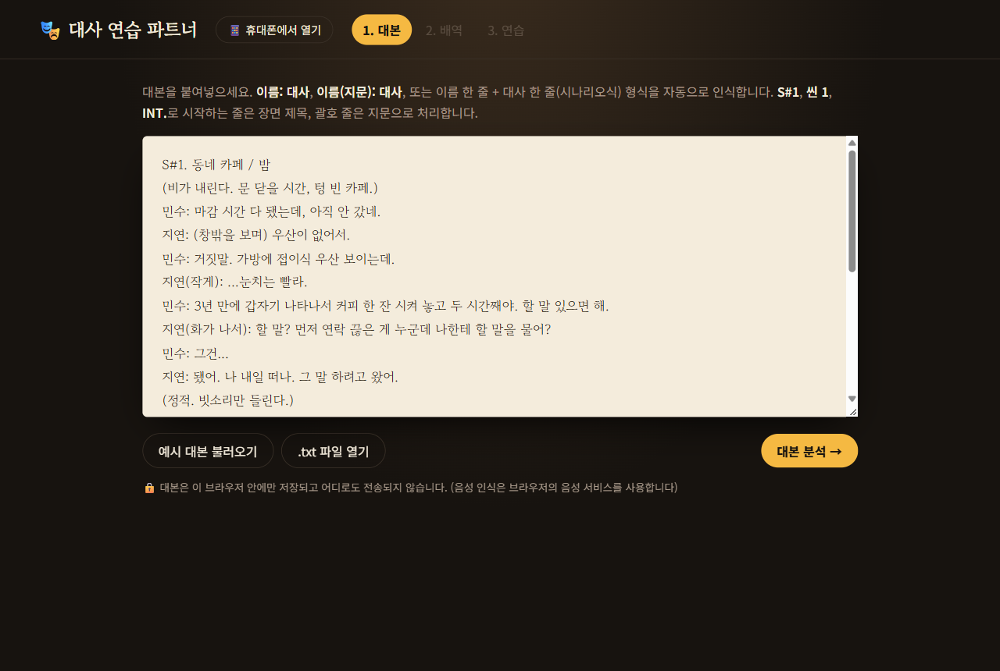
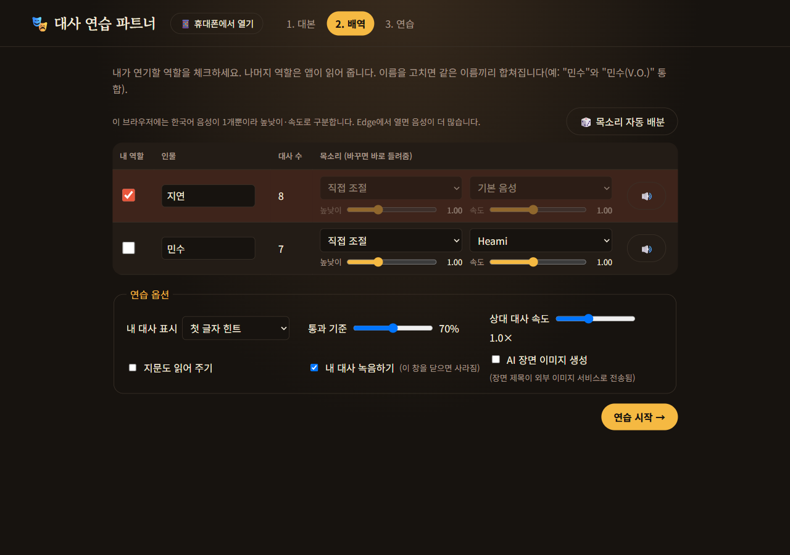
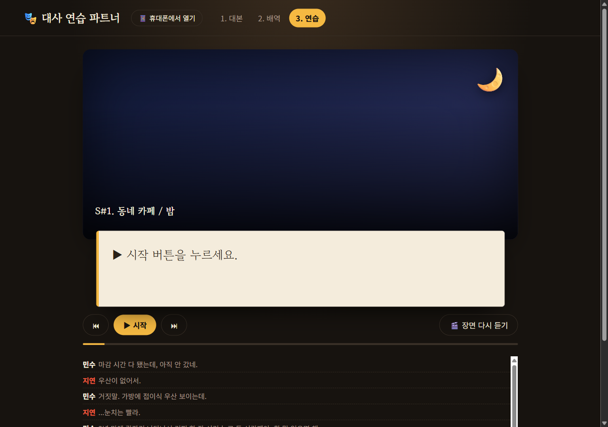
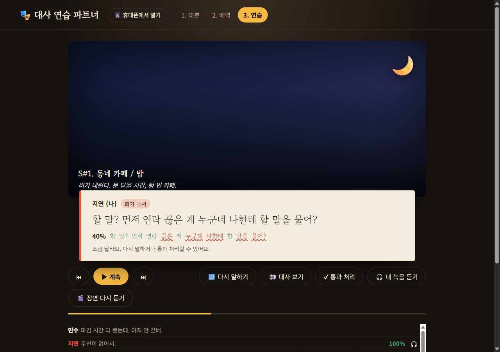
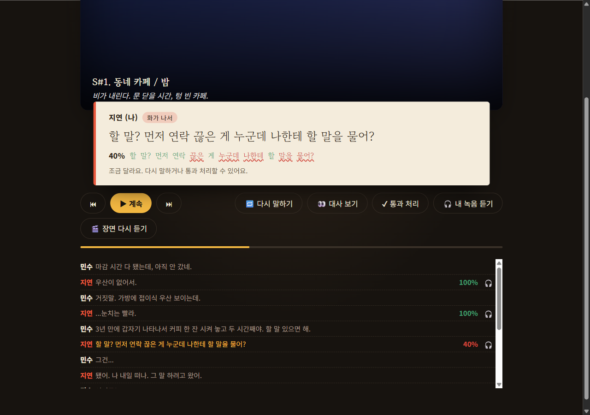
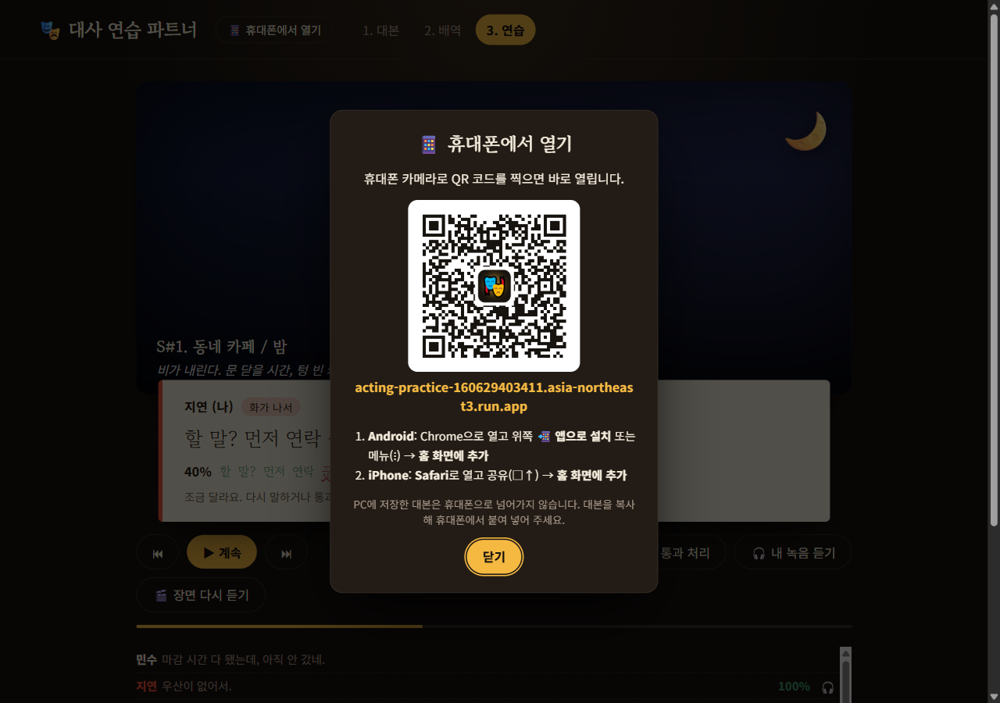
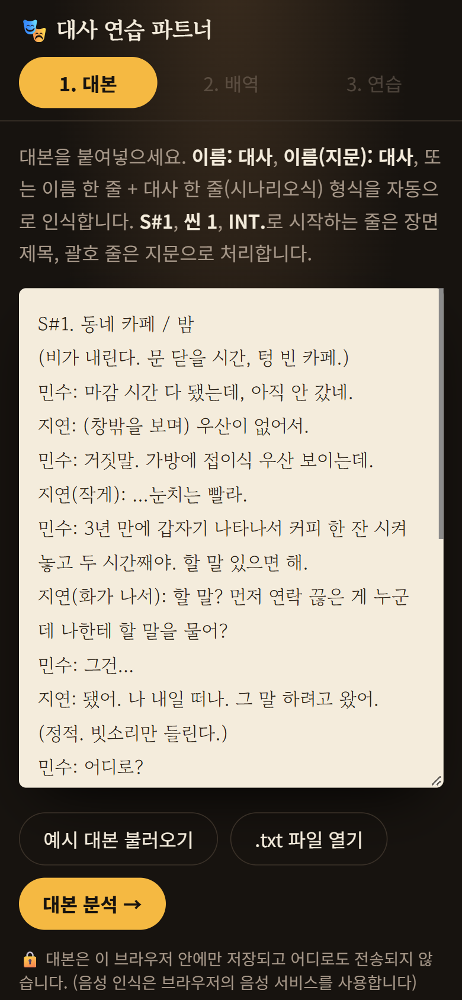
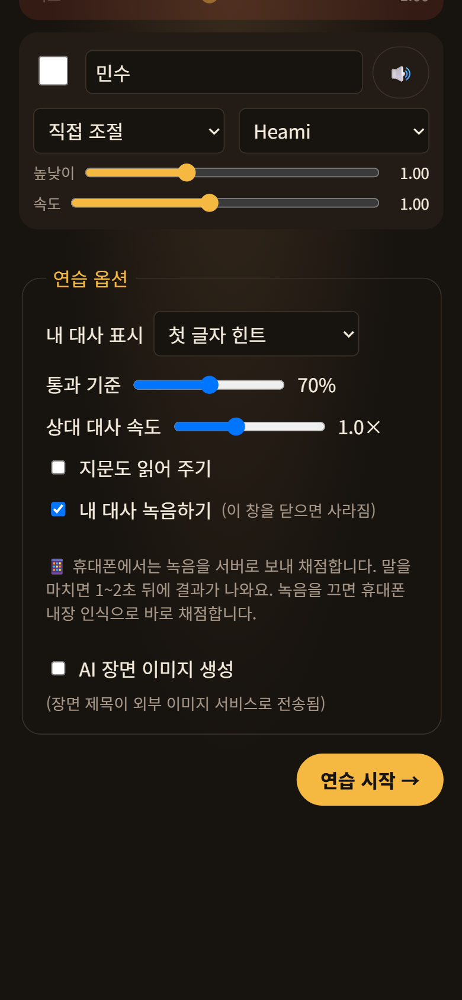

# 🎭 대사 연습 파트너 사용법

대본을 넣으면 **상대 배역을 앱이 읽어 주고**, 내 대사는 **말하면 자동으로 채점**하고, **녹음해서 다시 들려주는** 연기 연습 앱입니다.
설치할 것도, 회원가입도, 비용도 없습니다.

👉 **앱 주소: https://acting-practice-160629403411.asia-northeast3.run.app**

> 이 문서의 화면은 앱에 들어 있는 **예시 대본**으로 찍었습니다. 채점 화면은 "지연" 역할로 대사 세 줄을 말한 예시입니다.

---

## 한눈에 보기

```
① 대본 넣기  →  ② 내 역할 고르기  →  ③ ▶ 시작 → 상대 대사 듣고 내 대사 말하기  →  ④ 점수 확인 · 녹음 다시 듣기
```

| 준비물 | 설명 |
|---|---|
| 브라우저 | **Chrome, Edge**(PC·Android) 또는 **Safari**(iPhone·Mac) |
| 마이크 | 노트북 내장 마이크, 이어폰 마이크, 휴대폰 마이크 모두 OK |
| 인터넷 | 음성 인식에 필요합니다 |

---

## 1. 대본 넣기



1. 위쪽 **1. 대본** 탭에서 큰 입력칸에 대본을 붙여 넣습니다.
   - 처음이라면 **예시 대본 불러오기**를 눌러 연습용 대본으로 먼저 해 보세요.
   - 가지고 있는 대본 파일은 **📄 대본 파일 열기**로 불러올 수 있습니다. **txt · PDF · Word(.docx) · 한글(.hwp · .hwpx, 옛 한글 97 포함) · .odt · .rtf**를 지원하고, 파일은 휴대폰·PC 안에서만 읽습니다.
   - 불러온 뒤 입력칸에서 내용을 확인하고 **대본 분석 →** 을 누르세요.
   - 스캔한 그림 PDF, 옛 Word(.doc), 배포용(보기 전용) 한글 문서는 글자를 꺼낼 수 없어 안내 문구가 나옵니다. 원본 문서로 열거나 내용을 복사해 붙여 넣어 주세요.
2. **대본 분석 →** 을 누릅니다.

### 이렇게 쓰면 자동으로 알아봅니다

```
S#1. 카페 / 밤          ← 장면 제목 (S#1, 씬 1, INT. 로 시작)
(비가 내린다)            ← 지문 (괄호로 감싼 줄)
민수: 늦었네.            ← 이름: 대사
지연(화가 나서): 왜?     ← 이름(지문): 대사  → 낭독할 때 감정에 반영
지연                     ← 시나리오식: 이름 한 줄
그만해.                  ←             대사 한 줄
상범 전 아직 총각입니다.  ← 희곡식: 이름 + 띄어쓰기 + 대사 (줄 앞에 자주 나오는 이름을 자동으로 찾음)
```

### 영어 대본

**English example** 버튼으로 영어 예시 대본을 불러올 수 있습니다. 대본 언어는 **자동 감지**되고(옆에 → English 표시), 직접 고를 수도 있습니다.
영어 대본이면 음성 인식·상대역 목소리·채점이 영어로 바뀝니다. (I'm과 I am, 20과 twenty는 같은 말로 채점)

```
INT. COFFEE SHOP - NIGHT     ← 장면 제목 (INT. / EXT. / SCENE 1)
Rain beats on the glass.     ← 지문
            MAYA             ← 시나리오: 대문자 이름 줄 (V.O.)·(CONT'D)는 떼고 인식
    You kept the place       ← 대사 (빈 줄이 나올 때까지 이어짐)
    exactly the same.
DANIEL: Why are you here?    ← NAME: line
NORA. I am leaving.          ← 희곡식 NAME. line
```

### 📚 무료 대본 서재

**📚 무료 대본 서재** 버튼을 누르면 저작권이 끝난(작가·번역가 사망 후 70년이 지난) 희곡을 바로 불러올 수 있습니다.

- 영어: 셰익스피어 「햄릿」「로미오와 줄리엣」「맥베스」「한여름 밤의 꿈」「오셀로」, 와일드 「진지함의 중요성」, 입센 「인형의 집」「헤다 가블러」
- 한국어: 이광수 「규한」, 조중환 「병자삼인」, 홍사용 「제석」

작품을 고르면 **전체** 또는 **막(ACT) 하나**만 골라 넣을 수 있습니다. 긴 작품은 막 하나만 넣는 것이 휴대폰에서 빠르고 AI 분석에도 알맞습니다.
목록에 없는 작품은 아래 **➕ 다른 작품 찾아서 불러오기**를 펼쳐서:

1. **Project Gutenberg 희곡 목록(영어)** 또는 **위키문헌 희곡 목록(한국어)** 버튼을 눌러 작품을 고릅니다.
2. 작품 페이지가 열리면 주소창의 주소를 복사합니다. (Gutenberg는 책 번호만 적어도 됩니다. 예: `1524`)
3. 앱으로 돌아와 **📋 붙여넣기** 또는 칸에 붙여 넣고 **불러오기**를 누릅니다.

소설처럼 희곡이 아니거나 스캔 이미지로만 된 작품이면 "대사를 찾지 못했어요"라고 알려 줍니다.
**📁 공유마당에서 파일로 받기**: **📜 저작권이 끝난 희곡 84편 목록**(채만식·함세덕·김정진·김우진 등 작가별)에서 제목을 누르면 공유마당 작품 페이지가 바로 열립니다. ⚡ 표시 작품(규한·흰 젖·노래주머니·인쇄한 러브레터)은 파일 없이 바로 불러옵니다. 작품 페이지에서 이용 조건 확인(「만료」는 자유롭게, 「CC」·「기증」은 적힌 조건 안에서) → 「다운로드」 → 앱으로 돌아와 **📄 받은 파일 열기**. (공유마당은 자동 내려받기를 막고 있어 파일은 직접 받아야 합니다.)
Internet Archive도 파일로 받아 **📄 대본 파일 열기**로 넣으세요. 직접 고른 작품은 작가·번역가가 세상을 떠난 지 70년이 넘었는지 꼭 확인하세요.

> 🔒 대본은 **내 브라우저 안에만** 저장되고 다른 곳으로 보내지 않습니다. 다음에 열어도 그대로 남아 있습니다.

---

## 2. 내 역할 고르기 (배역)



1. **내 역할** 칸에서 내가 연기할 인물을 체크합니다. (예: 지연 ✅)
   체크하지 않은 인물은 앱이 대신 읽어 줍니다.
2. 상대 인물의 **목소리**를 고를 수 있습니다.
   - **🤖 AI로 배역 분석 · 목소리 추천**을 누르면 대본을 읽고 인물마다 성별·나이대·성격·말투를 정리한 뒤, 어울리는 **Google 목소리**(남녀 29가지)와 말 속도를 골라 줍니다. 이름 아래 🤖 줄을 누르면 분석 내용과 추천 이유가 보입니다. (ⓘ를 누르면 설명)
   - 목소리 칸에서 **Google 목소리**(예: "남성 · 낮은 · 거칠고 묵직한")나 **이 기기의 음성**을 직접 고를 수 있습니다. 이 기기의 음성은 성격 프리셋과 **높낮이·속도**로, Google 목소리는 **속도**로 조절합니다.
   - 🔈 버튼을 누르면 바뀐 목소리를 바로 들려줍니다.
   - 상대 인물이 여러 명이면 **🎲 목소리 자동 배분**으로 서로 다른 목소리를 나눠 줍니다.
3. 아래 **연습 옵션**을 정하고 **연습 시작 →** 을 누릅니다.

| 연습 옵션 | 뜻 |
|---|---|
| **내 대사 표시** | **전체 보기**: 대사를 다 보여 줌 · **첫 글자 힌트**: 첫 글자만 · **숨기기**: 암기 테스트 |
| **통과 기준** | 이 점수 이상이면 👏 통과하고 다음 대사로 (기본 70%) |
| **계속 진행 기준** | 통과 기준에 못 미쳐도 이 점수를 넘으면 점수·틀린 곳을 잠깐 보여 주고 다음 대사로 넘어감 (기본 10%, 0~60%). 이하면 멈추고 🔁 다시 말하기·✔ 통과 처리를 기다림. 옵션 옆 ⓘ를 누르면 설명이 보임 |
| **상대 대사 속도** | 앱이 읽어 주는 속도 |
| **지문 줄도 읽어 주기** | 켜면 대사와 따로 떨어진 지문 줄을 해설 목소리로 읽어 줌. 대사 속 (괄호 지문)은 이 옵션과 상관없이 항상 화면에 보이고 해설 목소리로 읽어 줌(내 대사는 맨 앞 괄호만 말하기 전에 읽음). 괄호 지문은 채점하지 않음 |
| **내 대사 녹음하기** | 말한 대사를 녹음해 나중에 다시 들을 수 있음 (창을 닫으면 사라짐) |
| **AI 장면 이미지 생성** | 장면 제목으로 배경 그림을 만듦. 켜면 장면 제목이 외부 이미지 서비스로 전송됩니다 (기본 꺼짐) |

> 💡 이름을 고쳐 쓰면 같은 이름끼리 합쳐집니다. 예: "민수"와 "민수(V.O.)"를 둘 다 "민수"로 바꾸면 한 사람이 됩니다.

> ✏️ **이름 오타 합치기 제안**: 대본에 "서희"(소희 오타), "학"(상학), "배영민"(영민)처럼 오타나 다른 표기로 따로 나온 인물이 있으면, 배역 화면 위쪽에 **"→ 소희(으)로 합치기"** 버튼이 나옵니다. 누르면 대사가 합쳐지고, 실제로 다른 인물이면 **다른 인물이에요**를 누르세요. 자동으로 바꾸지는 않고 제안만 합니다.

---

## 3. 연습하기



1. **▶ 시작**을 누릅니다. (처음 한 번은 브라우저가 **마이크 사용 허용**을 물어봅니다 → **허용**)
2. 앱이 상대 대사를 읽어 줍니다.
3. 내 차례가 되면 아래에 **"듣고 있어요… 대사를 말해 주세요."** 가 나옵니다. 그때 내 대사를 말하면 됩니다.
4. 기준 점수를 넘으면 👏 **좋아요!** 와 함께 다음 대사로 자동으로 넘어갑니다.

### 틀렸을 때



- 점수(예: **40%**)와 함께 **맞게 말한 단어는 초록색**, **틀리거나 빠진 단어는 빨간 물결 밑줄**로 보여 줍니다.
- 이때 쓸 수 있는 버튼:

| 버튼 | 하는 일 |
|---|---|
| 🔁 **다시 말하기** | 같은 대사를 다시 말합니다 |
| 👀 **대사 보기** | 숨겨진 대사를 봅니다 |
| ✓ **통과 처리** | 점수와 관계없이 넘어갑니다 |
| 🎧 **내 녹음 듣기** | 방금 말한 내 목소리를 들어 봅니다 |
| ▶ **계속** | 멈춘 곳부터 이어서 합니다 |
| ⏮ / ⏭ | 이전 / 다음 대사로 이동 (⏭는 Space 키로도 됨) |

---

### 연습 범위 · 반복

연습 화면의 대본 목록 위 **범위**에서 고를 수 있습니다.

- **전체** / **장면 하나**(S#1, S#2 …)
- **⚠ 약한 대사만**: 마지막 점수가 통과 기준보다 낮았던 내 대사만, 바로 앞 상대 대사(신호)와 함께 연습합니다.
- **🔁 반복**을 켜면 범위 끝에서 처음으로 돌아갑니다. 약한 대사만 연습할 때는 통과한 대사가 다음 바퀴에서 빠지고, 모두 통과하면 끝납니다.

### 📊 연습 기록

연습 화면의 **📊 기록**을 누르면 오늘 연습 시간·말한 대사 수·통과율·평균 점수, 최근 7일 막대 그래프, 이 대본의 약한 대사, 자주 틀린 낱말을 볼 수 있습니다. **⚠ 약한 대사만 연습하기**로 바로 연습을 시작할 수 있어요. 기록은 이 휴대폰·PC에만 60일 동안 저장됩니다.

---

## 4. 결과 보기 · 녹음 다시 듣기



- 아래 **대본 목록**에서 내 대사마다 **점수**(초록 = 통과, 빨강 = 미달)와 🎧 버튼이 보입니다.
  - 🎧 를 누르면 그 줄의 내 녹음을 들려줍니다.
  - 줄을 누르면 그 대사로 바로 이동합니다.
- 🎬 **장면 다시 듣기**: 상대 대사(앱 음성)와 **내 녹음**을 이어 붙여 장면 전체를 한 번에 들려줍니다. 내 연기를 장면 흐름 속에서 확인할 수 있어요.
- 끝까지 하면 평균 점수가 나오고, **↺ 처음부터**로 다시 시작할 수 있습니다.

---

## 4-1. 작품 분석: 초목표 · 관계도

**4. 분석** 탭에서 대본 전체와 배역들을 정리해 볼 수 있습니다.

1. **🤖 AI로 초목표·관계도 그리기**를 누르면 AI가 대본을 읽고 초안을 씁니다. (ⓘ를 누르면 설명)
   - **작품 전체**: 초목표(작품이 끝내 말하려는 것) · 주제 · 관통행동 · 줄거리
   - **배역별**: 초목표 · 관통행동 · 장애물 · 근거가 되는 대사 (내 배역이 맨 앞)
   - **인물 관계도**: 관계 종류마다 색이 다른 선(사랑·가족·우정·일, 점선은 경쟁·적대), 한쪽만 향하는 마음은 화살표. 관계가 가장 많은 인물이 가운데에 놓입니다.
2. 모든 칸은 눌러서 **내 해석으로 고칠 수 있고**, 고친 내용은 이 브라우저에 자동 저장됩니다.
3. **🖼 관계도 이미지로 저장**으로 그림 파일을, **📋 텍스트 복사**로 노션·메신저에 붙여 넣을 글을 얻을 수 있습니다.

> 대본을 새로 분석하면(1. 대본에서 다른 대본으로 '대본 분석') 이전 대본의 작품 분석은 지워집니다.

---

## 5. 휴대폰에서 쓰기

### 휴대폰으로 열기



- PC 화면 위쪽 **📱 휴대폰에서 열기**를 누르면 QR 코드가 나옵니다. 휴대폰 카메라로 찍으면 바로 열립니다.
- PC에 넣은 대본은 휴대폰으로 넘어가지 않습니다. 대본을 복사해서 휴대폰에서 붙여 넣으세요.

### 홈 화면에 앱으로 설치

| 기기 | 방법 |
|---|---|
| Android | Chrome으로 열기 → 위쪽 **📲 앱으로 설치**, 또는 메뉴(⋮) → **홈 화면에 추가 / 앱 설치** |
| iPhone · iPad | **Safari**로 열기 → 아래쪽 공유 버튼(□↑) → **홈 화면에 추가** |
| PC | Chrome/Edge 주소창 오른쪽 설치 아이콘(⊕), 또는 **📲 앱으로 설치** |

<table>
<tr>
<td width="50%"></td>
<td width="50%"></td>
</tr>
<tr>
<td align="center">휴대폰 대본 화면</td>
<td align="center">휴대폰 연습 옵션 (녹음 안내)</td>
</tr>
</table>

### 휴대폰에서 달라지는 점

- 휴대폰은 **녹음을 서버로 보내 채점**합니다. 그래서 말을 마치고 **1~2초 뒤에** 점수가 나옵니다.
  (휴대폰 브라우저는 녹음과 음성 인식을 동시에 못 하기 때문입니다. 이 방식이면 휴대폰에서도 채점과 녹음 다시 듣기가 둘 다 됩니다.)
- 말이 끝나면 **자동으로 녹음이 멈춥니다.** 조용한 곳에서 하면 더 정확합니다.
- **내 대사 녹음하기**를 끄면 휴대폰 내장 음성 인식으로 바로 채점합니다(녹음 다시 듣기는 안 됨).

---

## 6. 문제가 생겼을 때

| 증상 | 해결 방법 |
|---|---|
| **"🚫 마이크가 차단되어 있습니다"** | 주소창 왼쪽 🔒(또는 ⓘ) → **마이크 허용** → 새로고침. 홈 화면 앱이면 오른쪽 위 ⋯ → 사이트 권한 → 마이크 허용 |
| **"🎤 연결된 마이크가 없습니다"** | 이어폰 마이크·USB 마이크를 연결하고 🔁 **다시 말하기** |
| **"소리가 들리지 않았어요"** | 마이크에 조금 더 크게, 가까이 말해 보세요. 그래도 안 되면 앱을 **완전히 닫았다 다시 열기**. 문구 아래 **[진단]** 줄을 개발자에게 보내 주시면 원인을 찾을 수 있습니다 |
| **iPhone에서 소리가 안 남** | 처음에 ▶ 시작을 눌러야 소리가 납니다. 무음 모드(옆 스위치)도 확인하세요 |
| **iPhone에서 채점이 안 됨** | 설정 → Siri에서 Siri가 켜져 있어야 음성 인식이 됩니다 |
| **Firefox에서 채점이 안 됨** | Firefox는 음성 인식을 지원하지 않습니다. 대사를 말한 뒤 ⏭를 누르거나 Chrome·Edge를 쓰세요 |
| **목소리가 다 비슷함** | 🤖 AI로 배역 분석을 누르거나, 목소리 칸에서 Google 목소리를 고르세요. 🎲 목소리 자동 배분도 Google 목소리로 나눠 줍니다 |
| **"Google 목소리를 불러오지 못해…"** | 인터넷이 끊겼거나 하루 사용량을 다 쓴 경우입니다. 그동안은 이 기기의 기본 음성으로 읽어요 |

---

## 개인정보 · 저작권

- 대본은 **내 브라우저 안에만** 저장됩니다. 녹음은 창을 닫으면 사라집니다.
- 음성 인식은 브라우저 회사(구글·애플·MS)의 음성 서비스를 거칩니다. 휴대폰에서 녹음을 켜고 쓰면 채점을 위해 내 대사 녹음이 서버를 거쳐 Google 음성 인식으로 전송되며, **서버는 녹음을 저장하지 않습니다.**
- 기성 대본을 개인 연습용으로 쓰는 것은 괜찮지만, **대본을 앱에 넣어 배포하거나 공유하지 마세요.**

← [프로젝트 README로 돌아가기](../README.md)
